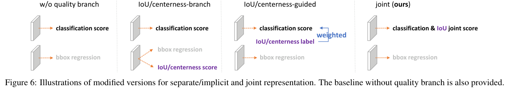
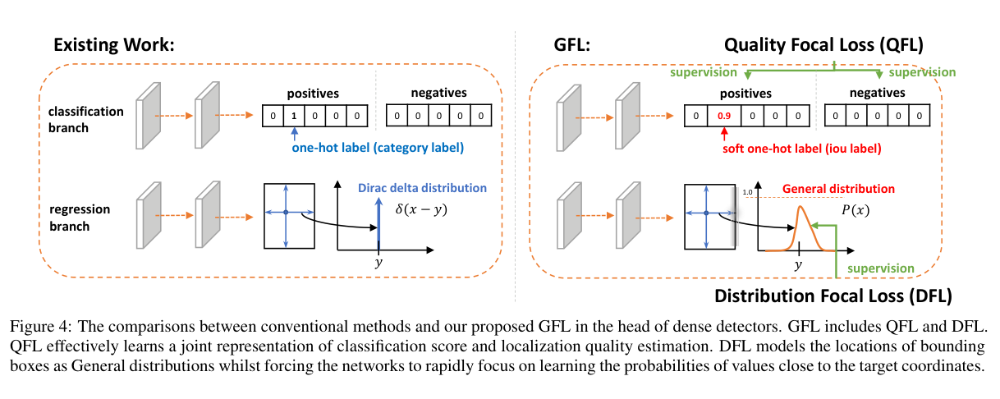
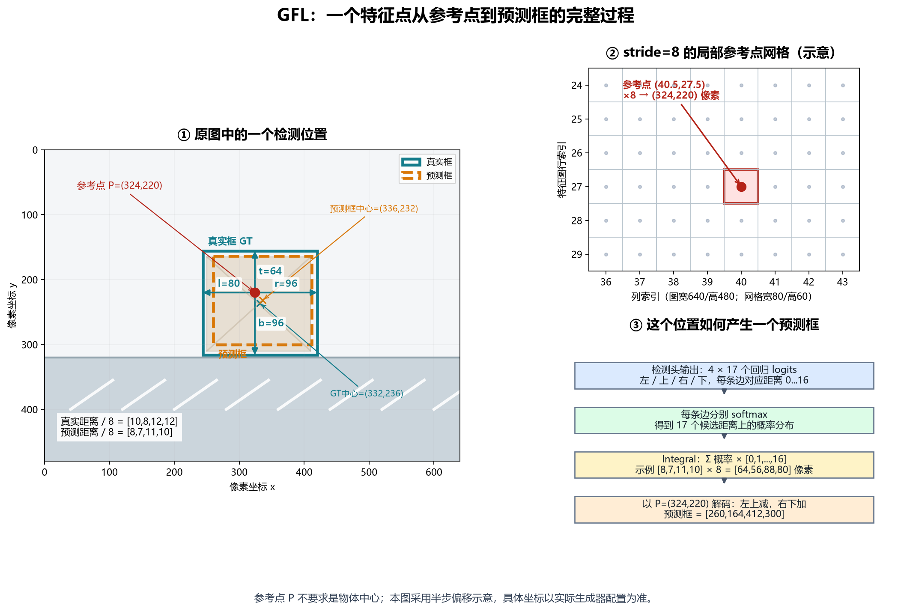
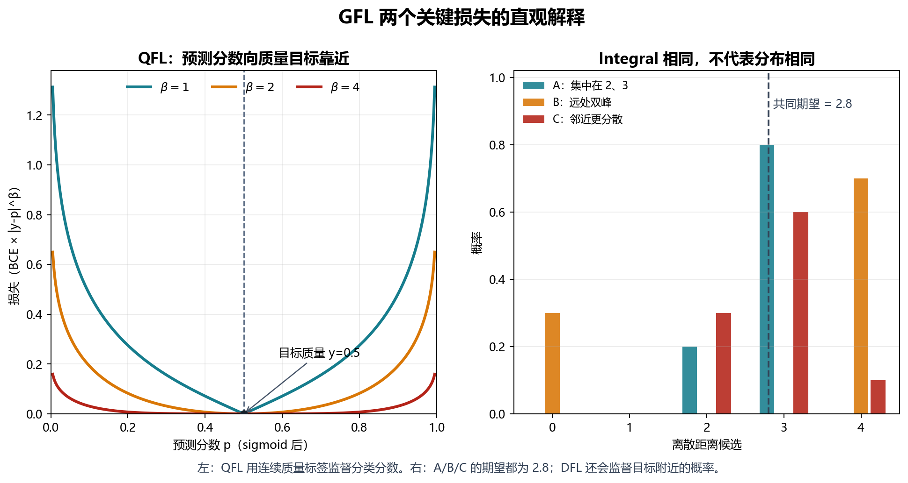
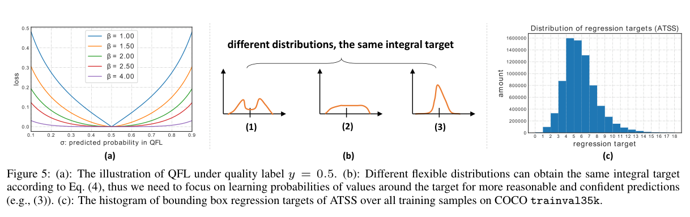
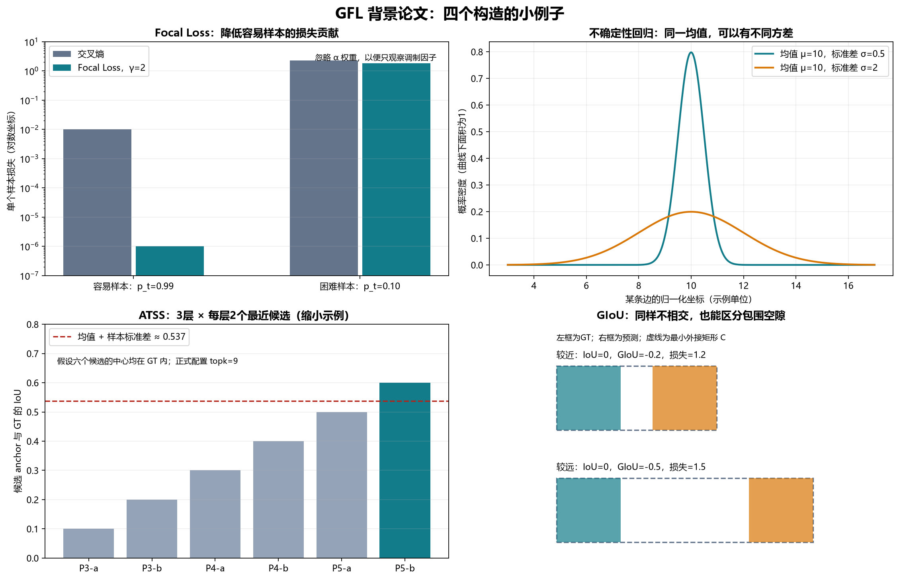

# GFL 论文组会讲解稿

论文：**Generalized Focal Loss: Learning Qualified and Distributed Bounding Boxes for Dense Object Detection**

作者：Xiang Li 等；NeurIPS 2020。

[论文摘要页](https://arxiv.org/abs/2006.04388) · [本地论文 PDF](papers/gfl_2006.04388.pdf) · [在线 PDF](https://arxiv.org/pdf/2006.04388)

这次主要讲论文的两个问题、QFL 和 DFL 的思路，以及它们在代码里的计算过程。训练实验不放进这次汇报。代码展示用的是手工构造张量的调试脚本，目的是把公式中的变量和程序中的张量对应起来。

---

## 1. 开场：我为什么从蒸馏读到了 GFL（约 2 分钟）

我最开始读的是 CrossKD，在介绍中遇到了定位蒸馏 LD。LD 用边界框的概率分布来传递定位知识，我对这个表示不熟悉，就继续看它引用的 GFL。

所以这次先把一个基础问题讲清楚：**目标检测中，边界框为什么可以表示成概率分布，这个分布又怎么训练？**

GFL 本身是目标检测论文，不是蒸馏方法。它提供的分类质量分数、四条边的概率分布，是理解后续检测蒸馏时需要掌握的输出表示。

我会围绕三个问题展开：

1. 为什么分类分数高，不代表框的位置好？
2. 为什么一个框要输出 68 个回归数，而不是 4 个？
3. QFL、DFL 和 GIoU 分别监督什么，代码里怎么连接？

## 2. 第一个问题：分类对了，框不一定画得准（约 4 分钟）

假设图片里有一个人，模型给出两个框：

| 候选框 | person 分类分数 | 与真实框的 IoU |
|---|---:|---:|
| A | 0.95 | 0.55 |
| B | 0.85 | 0.90 |

A 更有把握地说“这是人”，B 却把人的位置框得更准。如果两个候选框之间重叠较大，NMS 按分类分数排序，A 就可能先被保留、B 被抑制。

这里的 0.55、0.90 是候选框与真实框的 IoU；NMS 判断是否互相抑制，用的是候选框 A 与 B 的 IoU。两个 IoU 的对象不同，不能混在一起。

普通分类的正样本目标通常是 1。也就是说，只要是正样本，定位不够准的 A 和定位很准的 B，都可能被要求输出很高的类别分数。分类监督本身没有充分表达框的定位质量。

已有方法会增加单独的 IoU 或 centerness 分支，再把质量分数和分类分数结合。GFL 则直接让分类分支学习“类别与定位质量的联合分数”。

### 看原文 Figure 6：质量信息放在哪里

*来源：GFL 原文 Figure 6，保留原图及图注。*

从左到右可以这样讲：

- **没有质量分支**：分类只负责类别，回归负责框。
- **单独质量分支**：另预测 IoU 或 centerness，推理时组合分数。
- **质量指导分类**：用质量标签调整分类训练，但要区分它与联合表示的监督方式。
- **GFL 联合表示**：分类输出直接带定位质量，推理时直接用于候选排序。

讲到这里先留一个问题：如果正样本分类目标从 1 变成 0.7，原来的 Focal Loss 该怎么改？这就是后面的 QFL。

## 3. 第二个问题：一条边不一定能用一个确定数字表达（约 3 分钟）

假设一辆车的一部分被树挡住。可见部分能确定，但被遮挡的左边界究竟在哪里，判断可能没有那么明确。

普通回归最后只给一个数。例如左边界坐标是 100。这个数本身不告诉我们：模型是很确定边界在 100 附近，还是认为 90 到 110 都有可能。

GFL 用距离上的概率分布表示每条边，再取期望得到一个连续距离。它的区别是没有先假定预测分布必须为单个高斯形状，而是让网络输出各离散候选距离的概率。

这里有一个边界要记住：分布形状能携带定位不确定性相关信息，但不代表训练出的概率已经是经过校准的真实误差概率。

### 看原文 Figure 4：GFL 改了哪两处

*来源：GFL 原文 Figure 4。*

我按上、下两条线讲：

- 上面是分类：原来真实类别目标为 1，GFL 的真实类别目标换成当前预测框的 IoU，例如 0.9，用 **QFL** 监督。
- 下面是回归：原来每条边输出一个数，现在输出一个分布，用 **DFL** 辅助监督，并通过期望解码得到最终框。

它仍然有分类和回归分支，不是把分类与回归合成一个输出数字。

## 4. 从一个参考点讲清楚框怎么预测（约 6 分钟）

### 4.1 先分清三个点

我之前容易混淆“参考点”和“框中心”，这里先单独讲清楚。

1. **参考点**：由特征图网格与步长决定，是回归距离的起点。
2. **真实框中心**：由标注框左右、上下边界取平均得到。
3. **预测框中心**：由预测框左右、上下边界取平均得到。

它们不要求重合。

“以一个参考点预测框”是从这个点出发预测到四条边的距离，不是要求这个点成为框的中心。

### 4.2 stride=8 的构造例子

*自绘教学示意。图片宽 640、高 480，对应宽 80、高 60 的 stride=8 网格；图中采用半步偏移。具体参考点坐标以生成器配置为准。*

按图从左到右讲：

参考点：

$$
P=(324,220).
$$

真实框坐标：

$$
B^*=(244,156,420,316).
$$

相对 P 的四条边距离是：

$$
l=324-244=80,\quad t=220-156=64,
$$

$$
r=420-324=96,\quad b=316-220=96.
$$

所以：

$$
(l,t,r,b)=(80,64,96,96).
$$

真实框中心是 (332,236)，它并不是参考点 P。

除以 stride=8 后，距离变成特征图单位：

$$
(10,8,12,12).
$$

假设模型最终预测出的距离是 (8,7,11,10)，换回像素为 (64,56,88,80)，解码得到：

$$
\hat B=(324-64,\ 220-56,\ 324+88,\ 220+80)
      =(260,164,412,300).
$$

这个预测框中心是 (336,232)，同样不等于 P。预测左右距离不同，框中心自然就会偏离参考点。

真实框和预测框只是**用同一个参考点描述**。真实框来自人工标注；训练代码把它转换成相对距离作为监督。

### 4.3 FPN 有五层，位置数怎么算

当前配置的 stride 是 8、16、32、64、128，每个位置对应一个回归候选，因此总位置数是：

$$
K=\sum_{\ell=1}^{5} H_\ell W_\ell.
$$

如果某个普通 anchor 检测器每个位置放 A 个 anchor，则候选数是：

$$
K=\sum_{\ell=1}^{5} H_\ell W_\ell A.
$$

当前 GFL 配置每个位置只有一个 anchor，所以 A=1。注意：**当前 MMDetection 仍生成 anchor 给 ATSS 做样本分配，回归时取 anchor 的中心点作为距离参考。** 因而“没有多个宽高比模板的回归输出”不等于“代码里完全不存在 anchor”。

正式代码在 [anchor_center](../mmdetection/mmdet/models/dense_heads/gfl_head.py#L220) 中用：

    anchors_cx = (anchors[..., 2] + anchors[..., 0]) / 2
    anchors_cy = (anchors[..., 3] + anchors[..., 1]) / 2

求出参考点。

我的调试脚本为了简化，构造了 [x,y,x,y] 这种退化框，所以可以直接取前两列作为参考点。正式的 [x1,y1,x2,y2] anchor 不能一般地这样取。

### 4.4 训练时谁来决定正样本

真实框不是分配给所有位置。当前配置用 ATSSAssigner 确定哪些候选负责哪些真实目标。

理解上先记住：**样本分配发生在损失之前。** 分类监督覆盖正样本和背景；回归损失主要对正样本计算。ATSS 的具体小例子放在第 10 节。

## 5. 先把输出张量和 68 个数弄明白（约 3 分钟）

单个 FPN 层，输入 batch 大小为 N、特征图高宽为 H、W，COCO 类别数为 80：

| 张量 | 原始形状 | 展平后 |
|---|---|---|
| 分类 logits | (N,80,H,W) | (N×H×W,80) |
| 回归 logits | (N,68,H,W) | (N×H×W,68) |
| 类别标签 | (N,H×W) | (N×H×W,) |
| 真实框目标 | (N,H×W,4) | (N×H×W,4) |

每个位置一个类别标签，不是四个。一个正样本位置负责一个真实框；同一个真实框可以分配到多个正样本位置。

正样本数量记为 M，则：

- 正样本回归 logits 为 (M,68)。
- 分成四条边后为 (4M,17)。
- 四条边距离目标为 (4M,)。

为什么是 68：

$$
4\times(\mathrm{reg\_max}+1)=4\times17=68.
$$

每条边对应距离候选 0、1、…、16。这里单位是相应层的 stride，不是只能预测 0 到 16 个像素。

目标距离也不是任意大都能被 0 到 16 夹住。实现会对目标距离做范围限制，例如 [bbox2distance](../mmdetection/mmdet/structures/bbox/transforms.py#L206) 使用上界减 eps 的 clamp，避免右侧整数索引越界。这也是多层尺度、样本分配与距离范围要一起考虑的原因。

代码入口：[输出层定义](../mmdetection/mmdet/models/dense_heads/gfl_head.py#L166)、[当前模型配置](../mmdetection/configs/gfl/gfl_r50_fpn_1x_coco.py#L30)。

## 6. Integral 和 DFL：一条边的完整计算（约 7 分钟）

### 6.1 Integral 对应论文公式（5）

一条边的 logits 记为 z，softmax 得到：

$$
S_i=\frac{e^{z_i}}{\sum_{j=0}^{16}e^{z_j}}.
$$

再求期望：

$$
\hat y=\sum_{i=0}^{16} iS_i.
$$

这里的候选距离 i 是固定的 0 到 16，S_i 是网络当前输出的概率。训练修改网络参数后，logits 和概率随下一次前向计算改变。

比如只有 2、3 两处有概率：

$$
S_2=0.2,\qquad S_3=0.8
$$

就有：

$$
\hat y=2\times0.2+3\times0.8=2.8.
$$

正式实现：[Integral.forward](../mmdetection/mmdet/models/dense_heads/gfl_head.py#L42)。

    x = F.softmax(x.reshape(-1, self.reg_max + 1), dim=1)
    x = F.linear(x, self.project.type_as(x)).reshape(-1, 4)

第一行把每条边的 17 个 logits 分开归一化。第二行与固定的 [0,1,…,16] 做点积，再还原成每个框四条距离。project 是 buffer，不是需要优化的网络权重。

### 6.2 为什么有了框损失，还需要 DFL

只约束期望，不能唯一确定分布。例如：

| 分布 | 非零概率 | 期望 |
|---|---|---:|
| A | P(2)=0.2，P(3)=0.8 | 2.8 |
| B | P(0)=0.3，P(4)=0.7 | 2.8 |
| C | P(2)=0.3，P(3)=0.6，P(4)=0.1 | 2.8 |

三者输出同一个距离，概率形状却不一样。DFL 会引导概率集中到真实距离附近的相邻整数。

*自绘公式示意：右图的三种分布都具有 2.8 的期望。*

### 6.3 DFL 对应论文公式（6）

真实距离 y=2.8，取相邻整数：

$$
y_l=2,\qquad y_r=3.
$$

两个权重由真实距离在区间内的位置决定：

$$
w_l=y_r-y=0.2,\qquad w_r=y-y_l=0.8.
$$

DFL：

$$
\mathcal L_{\mathrm{DFL}}
=-(y_r-y)\log S_{y_l}-(y-y_l)\log S_{y_r}
=-0.2\log S_2-0.8\log S_3.
$$

这两个权重来自标注距离，不是网络预测的概率。理想的 DFL 最优分布才是在这两个位置分配 0.2 和 0.8。

正式实现：[distribution_focal_loss](../mmdetection/mmdet/models/losses/gfocal_loss.py#L144)。

    dis_left = label.long()
    dis_right = dis_left + 1
    weight_left = dis_right.float() - label
    weight_right = label - dis_left.float()

    loss = F.cross_entropy(pred, dis_left, reduction='none') * weight_left \
         + F.cross_entropy(pred, dis_right, reduction='none') * weight_right

对于非负目标，long 相当于向下取整。cross_entropy 输入 logits，内部做 log-softmax，再取目标类别的负对数概率。

注意：这是 **17 选 1 的距离分类交叉熵加权**，不是把不同目标类别的分类损失相加。分类头的 80 类和回归头每边的 17 个距离候选，是两套不同含义。

### 6.4 用已经算过的五候选例子检查理解

为方便手算，只保留距离 0 到 4 五个候选。假设 logits 全为 0，则每个概率都是 0.2，真实距离仍是 2.8：

$$
-\log0.2\approx1.6094,
$$

$$
\mathcal L_{\mathrm{DFL}}
=0.2\times1.6094+0.8\times1.6094
=1.6094.
$$

目标软分布为 [0,0,0.2,0.8,0]，初始 logits 梯度是：

$$
S-q=[0.2,0.2,0,-0.6,0.2].
$$

第 3 号距离的 logit 会在梯度下降时增大。第 2 号 logit 当前梯度为 0，也不意味着它的 softmax 概率永远不变，因为其他 logits 更新后，归一化分母也会改变。

还有一个容易忽略的点：DFL 最优值一般不为 0。对于 0.2/0.8 的目标分布，理论最优值为：

$$
-0.2\log0.2-0.8\log0.8\approx0.5004.
$$

它是软目标的熵。因此不能看到 DFL 没降到 0，就认为代码错了。

## 7. QFL：把分类标签从 1 换成定位质量（约 6 分钟）

### 7.1 一个三类别的小例子

假设类别顺序为 [person,car,dog]，该正样本的真实类别是 car。预测框与它所分配的真实框 IoU 为 0.7。

普通分类目标：

$$
[0,1,0].
$$

QFL 目标：

$$
[0,0.7,0].
$$

背景位置则是 [0,0,0]。GFL 使用每类独立 sigmoid，而不是用 softmax 强迫三类概率之和为 1。

这里 car 分数不是“它有 70% 的概率是汽车”这么简单。监督要求它同时反映类别正确性与这个框的定位质量。

### 7.2 QFL 对应论文公式（2）

设 p 是某一类别 sigmoid 后的输出，q 是该类别的连续质量目标：

$$
\mathrm{BCE}(p,q)
=-q\log p-(1-q)\log(1-p),
$$

$$
\mathcal L_{\mathrm{QFL}}
=|q-p|^\beta\mathrm{BCE}(p,q).
$$

当前配置 beta=2。

以 q=0.7 为例：

| 预测 p | 与质量目标差距 | BCE | 调制因子 | QFL |
|---|---:|---:|---:|---:|
| 0.2 | 0.5 | 约 1.1935 | 0.25 | 约 0.2984 |
| 0.6 | 0.1 | 约 0.6325 | 0.01 | 约 0.0063 |
| 0.7 | 0 | 约 0.6109 | 0 | 0 |

预测已经接近目标，就减小该项损失；偏离目标较多，就需要继续学习。上表比较的是当前损失数值，实际参数更新由梯度决定。

### 7.3 IoU 标签从哪里来

在 [GFLHead.loss_by_feat_single](../mmdetection/mmdet/models/dense_heads/gfl_head.py#L288) 中：

    pos_bbox_pred_corners = self.integral(pos_bbox_pred)
    pos_decode_bbox_pred = self.bbox_coder.decode(
        pos_anchor_centers, pos_bbox_pred_corners)

    score[pos_inds] = bbox_overlaps(
        pos_decode_bbox_pred.detach(),
        pos_decode_bbox_targets,
        is_aligned=True)

顺序是：回归分布 → 期望距离 → 预测框 → 与对应真实框算 IoU → 赋给 QFL 质量目标。

所以这个目标随预测框变化，是动态的。推理时没有真实框，不再现场算这个 IoU 标签，而是直接使用分类分支学到的联合分数。

detach 表示这里把当前 IoU 当作监督目标，不让 QFL 沿着“质量标签的生成路径”反传回框坐标。回归分支仍由 GIoU 和 DFL 监督。

### 7.4 正式 QFL 代码怎么读

入口：[quality_focal_loss](../mmdetection/mmdet/models/losses/gfocal_loss.py#L13)。

先把所有位置、所有类别按目标 0 计算：

    pred_sigmoid = pred.sigmoid()
    loss = F.binary_cross_entropy_with_logits(
        pred, zerolabel, reduction='none') * pred_sigmoid.pow(beta)

再把正样本真实类别这一格，替换成 IoU 目标的损失：

    scale_factor = score[pos] - pred_sigmoid[pos, pos_label]
    loss[pos, pos_label] = F.binary_cross_entropy_with_logits(
        pred[pos, pos_label], score[pos], reduction='none'
    ) * scale_factor.abs().pow(beta)

“先算全零目标，再替换正样本格子”是一种向量化实现方式，不是训练分了两次。

## 8. GIoU、DFL、QFL 的分工（约 3 分钟）

| 损失 | 比较什么 | 主要监督谁 |
|---|---|---|
| QFL | 类别分数与质量目标 | 分类分支 |
| GIoU | 最终预测框与对应真实框 | 回归分支解码后的框 |
| DFL | 边距离分布与相邻距离软目标 | 回归分支的四组分布 |

GIoU loss 的逐框原始值就是 1-GIoU；配置中的 loss_bbox 还包含加权与归一化，所以日志中的 loss_bbox 不能简单等同于一个框的 1-IoU。

代码：[giou_loss](../mmdetection/mmdet/models/losses/iou_loss.py#L122)。GIoU 的几何例子见第 10 节。

### weight_targets 不是 IoU 标签

当前实现：

    weight_targets = cls_score.detach().sigmoid()
    weight_targets = weight_targets.max(dim=1)[0][pos_inds]

它取正样本位置的**最大类别联合分数**，给 GIoU 和 DFL 加权；不一定是该位置真实类别对应的那一个分数，也不直接等于当前 IoU。

四条边共用一个正样本权重：

    weight_targets[:, None].expand(-1, 4).reshape(-1)

例如两个正样本权重是 [0.8,0.3]，展开后为 [0.8,0.8,0.8,0.8,0.3,0.3,0.3,0.3]。

这里是“每条边的损失 × 对应样本权重”，没有把各项损失互相相乘。低权重也不代表标注是假的；正样本身份由分配器决定，低分还可能来自困难样本或训练尚不充分。

### 多层如何组织

[loss_by_feat_single](../mmdetection/mmdet/models/dense_heads/gfl_head.py#L233) 返回该层三项损失和回归权重和。

[loss_by_feat](../mmdetection/mmdet/models/dense_heads/gfl_head.py#L325) 用 multi_apply 对各 FPN 层分别计算，再对回归两项做跨层权重归一化，返回每种 loss 的列表。训练框架随后将各层损失汇总。

理解总目标可以写：

$$
\mathcal L
=\mathcal L_{\mathrm{QFL}}
+\lambda_0\mathcal L_{\mathrm{GIoU}}
+\lambda_1\mathcal L_{\mathrm{DFL}},
$$

但这里每项都应理解成完成相应加权与归约之后的量。当前配置 loss_weight 为 1、2、0.25，DFL 调用中还有四条边的平均；不要再手动重复乘配置权重。

## 9. 为什么论文名字叫 Generalized Focal Loss（备用约 2 分钟）

论文不只是把两个名字放在一起，还给出了统一形式，见公式（7）：

$$
\mathrm{GFL}(p_l,p_r)
=-|y-(y_lp_l+y_rp_r)|^\beta
\left[(y_r-y)\log p_l+(y-y_l)\log p_r\right],
$$

其中：

$$
p_l+p_r=1,\qquad y_l\le y\le y_r.
$$

可以先把它拆成“预测与连续目标之间的误差调制因子”和“两端概率的加权交叉熵”两部分。

- 取 y_l=0、y_r=1，p_r=p、p_l=1-p，就得到 QFL。
- 取 y_l、y_r 为真实距离两侧的相邻整数，并取 beta=0，就对应 DFL 的两邻居加权形式。
- 连续目标退化成 0 或 1 时，QFL 又回到常见 FL 形式（这里忽略 alpha 权重）。

正式 DFL 是对完整 17 维 softmax 做监督。只有达到理想目标分布时，两个相邻位置的概率才趋近于加起来为 1；不能说训练全程只输出两个概率。

### 原文 Figure 5 怎么讲

*来源：GFL 原文 Figure 5。*

- **左图**：固定质量目标 q=0.5，不同 beta 的 QFL 都在预测等于目标时达到最小值。
- **中图**：不同分布可以有相同期望，说明只约束最终距离不能确定分布形状，这是引出 DFL 的关键。
- **右图**：作者统计的回归目标分布，帮助说明离散支持范围选择的背景；它不是网络输出的某条边概率分布，也不表示换一个数据集仍有同样统计。

## 10. 五篇背景论文：今晚用小例子讲清关系

这五篇是截图里列出的关联文献。这里按理解 GFL 的顺序整理：FL → FCOS → ATSS → 不确定性回归 → GIoU。我目前只读了 FL 的一部分，其他先围绕 GFL 涉及的概念梳理，完整方法细节以后再补。

不用把这五篇各讲成一次完整论文汇报。它们分别帮助回答：哪些样本值得关注、框怎么表示、谁负责预测、边界有多确定、最终框怎么比较。

*自绘示意。图中所有数值都是帮助理解的构造例子，不是论文实验结果。FCOS 的参考点与四边距离见第 4 节。*

### 10.1 Focal Loss for Dense Object Detection

**ICCV 2017，Tsung-Yi Lin 等。**

[论文](https://arxiv.org/abs/1708.02002) · [正式实现](../mmdetection/mmdet/models/losses/focal_loss.py)

#### 它想解决什么

密集检测会产生大量背景候选。模型训练到一定程度后，大多数背景已经很好判断，但数量太多，仍可能主导总损失。FL 通过降低容易样本的贡献，缓解容易负样本占主导的问题。

#### 一个容易样本与困难样本

用 p_t 表示“对正确二元标签的预测概率”。真实类别为前景时 p_t=p；真实类别为背景时 p_t=1-p。

忽略 alpha，设 gamma=2：

$$
\mathrm{FL}(p_t)=-(1-p_t)^2\log p_t.
$$

| 样本 | p_t | 普通交叉熵 | FL 调制系数 | FL |
|---|---:|---:|---:|---:|
| 容易样本 | 0.99 | 约 0.01005 | 0.0001 | 约 0.000001005 |
| 困难样本 | 0.10 | 约 2.3026 | 0.81 | 约 1.8651 |

这不是简单按“背景就不学”，而是根据当前判断难度调节。已经学好的正样本也会降权，判断错的背景仍然会受到关注。

#### 它与 GFL 的关系

FL 的二元目标是 0 或 1。GFL 要让真实类别的目标变成 IoU，例如 0.7，因此把交叉熵与调制因子扩展到连续标签，形成 QFL。

**口头可以这样说：** FL 先解决“容易背景太多”，QFL 再解决“分类分数还需要反映定位质量”。

### 10.2 FCOS: Fully Convolutional One-Stage Object Detection

**ICCV 2019，Zhi Tian 等。**

[论文](https://arxiv.org/abs/1904.01355) · [代码入口](../mmdetection/mmdet/models/dense_heads/fcos_head.py)

#### 它想解决什么

FCOS 用每个特征位置作为预测起点，回归到四条边的距离，减少对多种预设 anchor 尺寸、比例的依赖。完整方法还包括分类、回归、centerness 和多尺度处理。

#### 用偏离中心的参考点预测真实框

真实框：

$$
B^*=(16,8,56,48),
$$

参考点：

$$
P=(32,24).
$$

则：

$$
(l,t,r,b)=(16,16,24,24).
$$

解码回去：

$$
(32-16,\ 24-16,\ 32+24,\ 24+24)
=(16,8,56,48).
$$

真实框中心是 (36,28)，参考点却是 (32,24)。这说明参考点不必是框中心，四条距离仍然足够恢复框。

#### centerness 是什么

FCOS 用几何中心程度抑制偏离中心的候选。其监督目标由真实四边距离构造：

$$
c^*=\sqrt{
\frac{\min(l,r)}{\max(l,r)}
\frac{\min(t,b)}{\max(t,b)}
}.
$$

以上例为：

$$
c^*=\sqrt{(16/24)(16/24)}=2/3.
$$

如果参考点在真实框正中央，左右距离相等、上下距离相等，centerness 为 1。

但 **centerness 不等于预测框 IoU**。它是这个参考位置相对真实框的几何中心程度；即使一个参考点很靠中心，模型也可能预测错距离。

#### 它与 GFL 的关系

FCOS 帮助理解参考点和 l/t/r/b 表示；GFL 进一步把每个直接回归的距离改成一组距离概率，通过 Integral 解码。不要把 FCOS 的直接回归、centerness 和 GFL 的 DFL、QFL 当成同一件事。

**口头可以这样说：** FCOS 帮我理解从哪个点画框，GFL 帮我理解每条距离怎么用分布预测。

### 10.3 Bridging the Gap Between Anchor-based and Anchor-free Detection via Adaptive Training Sample Selection

**CVPR 2020，Shifeng Zhang 等；简称 ATSS。**

[论文](https://arxiv.org/abs/1912.02424) · [ATSSAssigner](../mmdetection/mmdet/models/task_modules/assigners/atss_assigner.py)

#### 它想解决什么

anchor-based 与 anchor-free 方法之间的重要差异之一是正负样本如何定义。ATSS 提出一种根据目标自适应选择训练正样本的办法。

它不是用来预测融合权重的门控，也不是强化学习；这里的“自适应”指正样本选择规则会随目标候选分布变化。

#### 用三层、每层两个候选算一遍

正式 GFL 配置 topk=9。为手算，把它缩成三层 FPN，每层选择中心距离某个真实框中心最近的两个候选，共六个。

假设这六个候选 anchor 与真实框的 IoU 为：

$$
[0.1,0.2,0.3,0.4,0.5,0.6].
$$

均值为：

$$
\mu=0.35.
$$

按当前 PyTorch 实现的样本标准差约为：

$$
s\approx0.1871.
$$

阈值为：

$$
\tau=\mu+s\approx0.5371.
$$

若这六个候选的中心都在真实框内部，那么仅 IoU=0.6 的候选通过这一轮筛选。如果某候选同时匹配多个真实框，代码还要处理冲突，通常选对应 IoU 更高者。

这个小例子对应以下顺序：

1. **按距离挑候选**：各层分别选中心最近的 top-k。
2. **按 IoU 设阈值**：对该真实框的候选算均值与标准差。
3. **再检查中心在框内**：结合阈值和几何约束确定正样本。
4. **处理多目标冲突**。

第一步按中心距离选，不是先按最高 IoU 选。当前标准 ATSS 分配算的是候选 anchor 与真实框的 IoU，不要和 QFL 的“预测框与真实框 IoU”混淆。

#### 它与 GFL 的关系

ATSS 决定哪些位置负责哪个真实框，然后 GFL 才对这些正样本计算 DFL 和 GIoU，并构造 QFL 质量目标。

**口头可以这样说：** ATSS 决定谁来负责，GFL 的损失决定负责以后怎么学。

### 10.4 Bounding Box Regression with Uncertainty for Accurate Object Detection

**CVPR 2019，Yihui He 等。**

[论文](https://arxiv.org/abs/1809.08545) · [本地 PDF](papers/uncertainty_he_cvpr2019.pdf) · [作者代码仓库](https://github.com/yihui-he/KL-Loss)

#### 它想解决什么

目标边界会受遮挡、模糊、标注差异等影响。只回归一个坐标无法表达对这个坐标有多确定。这篇工作同时预测边界位置与定位方差，用高斯分布表示单个坐标，并据此设计回归损失和 variance voting。

#### 同一个坐标，确定程度不同

假设某条边的归一化坐标预测都是 10：

$$
X_A\sim\mathcal N(10,0.5^2),\qquad
X_B\sim\mathcal N(10,2^2).
$$

二者均值相同，但 A 的分布更窄、B 更宽。只看坐标 10 分不出来，方差则提供额外信息。

论文的一维高斯回归目标，忽略与网络参数无关的常数后，可写成：

$$
L=\frac{(x_g-\mu)^2}{2\sigma^2}
+\frac12\log\sigma^2.
$$

这里讨论归一化坐标，不直接拿像素和无量纲训练变量混算。

- 第一项：位置误差大，损失倾向增大；方差越大，该误差项的权重越小。
- 第二项：方差本身有代价，不能靠无上限增大方差来逃避训练。

令 x_g=10.5、mu=10。误差平方为 0.25。若 sigma²=1，则该简化损失为 0.125；若 sigma²=4，则约为 0.03125+0.6931=0.7244。可见，把方差调大不一定降低损失。

论文实际为稳定训练预测 log 方差，另对大残差使用平滑的损失形式；上式是理解高斯回归思想的入口，不是全部实现。

variance voting 则在融合相邻框坐标时考虑定位方差与重叠关系，让定位更确定的预测获得更高权重。它并不是 GFL 的 Integral，也不是多教师知识蒸馏。

#### 它与 GFL 的关系

二者都认为“只给一个确定数值”的定位表达不够充分。区别在于这篇采用高斯形状假设，用均值、方差参数化；GFL 输出离散候选距离上的概率，不预先限定为单个高斯形状。

**口头可以这样说：** 这篇告诉我定位也有不确定性，GFL 进一步选择了更灵活的分布表示。

### 10.5 Generalized Intersection over Union: A Metric and A Loss for Bounding Box Regression

**CVPR 2019，Hamid Rezatofighi 等；简称 GIoU。**

[论文](https://arxiv.org/abs/1902.09630) · [损失实现](../mmdetection/mmdet/models/losses/iou_loss.py#L122)

#### 它想解决什么

IoU 比较两个框的交集与并集：

$$
\mathrm{IoU}=\frac{|A\cap B|}{|A\cup B|}.
$$

若两个框不相交，IoU 都是 0。只用 1-IoU 时，在这类完全不相交的区域中不能有效反映它们的接近变化。

GIoU 引入能够同时包住两个框的最小外接矩形 C：

$$
\mathrm{GIoU}
=\mathrm{IoU}
-\frac{|C|-|A\cup B|}{|C|},
$$

$$
L_{\mathrm{GIoU}}=1-\mathrm{GIoU}.
$$

#### 两个都不相交的框，为什么损失不同

固定真实框：

$$
A=(0,0,2,2),\qquad |A|=4.
$$

比较两个同样面积为 4 的预测框：

| 预测框 | IoU | 并集面积 | 外接矩形面积 | GIoU | 1-GIoU |
|---|---:|---:|---:|---:|---:|
| B₁=(3,0,5,2) | 0 | 8 | 10 | -0.2 | 1.2 |
| B₂=(6,0,8,2) | 0 | 8 | 16 | -0.5 | 1.5 |

普通 IoU 都为 0；GIoU 则通过外接空隙对这两个例子给出不同数值。框完全一致时 GIoU=1、loss=0。

为什么用 1-GIoU：优化器通常最小化损失，而我们希望 GIoU 越大越好。减去它就把方向转换为“越小越好”。

GIoU 是几何指标，不是概率，也不是在所有框布局下都只由中心距离决定。例如一个框完全包含另一个时，外接空隙项可能为 0，GIoU 会退化为 IoU。

#### 它与 GFL 的关系

DFL 监督四条边的分布；Integral 解码后的最终框仍由 GIoU 约束。两者可以一起训练。

**口头可以这样说：** DFL 看边距离的概率分配，GIoU 看最后画出的框合不合适。

### 五篇各放在什么位置

| 论文 | 我需要掌握的核心概念 | 与 GFL 的联系 |
|---|---|---|
| FL | 易样本降权、困难样本学习 | QFL 的损失设计基础 |
| FCOS | 参考位置、l/t/r/b、centerness | 距离回归表示和质量分支背景 |
| ATSS | 根据候选统计分配正样本 | 当前配置的样本分配方法 |
| 不确定性回归 | 定位均值、方差、分布假设 | 概率边界框表示的相关研究 |
| GIoU | 最小外接矩形、最终框损失 | 当前 GFL 回归目标之一 |

## 11. 现场代码演示：按断点讲，不逐行念（约 6 分钟）

### 11.1 打开什么

主讲脚本：[debug_loss_single.py](debug_loss_single.py)。

需要细看注释时：[debug_loss_single_annotated.py](debug_loss_single_annotated.py)。

正式实现另外打开：

- [gfl_head.py](../mmdetection/mmdet/models/dense_heads/gfl_head.py)。
- [gfocal_loss.py](../mmdetection/mmdet/models/losses/gfocal_loss.py)。
- [distance_point_bbox_coder.py](../mmdetection/mmdet/models/task_modules/coders/distance_point_bbox_coder.py)。
- [bbox2distance](../mmdetection/mmdet/structures/bbox/transforms.py#L206)。

### 11.2 VS Code 操作

选中 DL 环境对应的 Python 解释器，打开主讲脚本，点击行号左侧设置断点。按 F5，选择 Python File。运行到断点后：

| 操作 | 快捷键 | 用途 |
|---|---|---|
| 单步跳过 | F10 | 执行当前行，不进入库内部 |
| 单步进入 | F11 | 进入自己写的解码或损失函数 |
| 跳出函数 | Shift+F11 | 回到调用处 |
| 继续到下个断点 | F5 | 跳过已经讲清的部分 |
| 查看变量 | 悬停 / Variables / Watch | 检查 shape 和数值 |

如果不使用图形调试器，可在项目根目录运行：

    python 汇报/debug_loss_single.py --trace

如果终端已经位于本汇报文件夹，直接运行 python debug_loss_single.py --trace 即可。

交互断点模式：

    python 汇报/debug_loss_single.py --trace --pdb

pdb 中输入 p 变量名 查看值，n 执行下一行，c 继续。命令要在装有 torch 的 DL 环境里运行。

### 11.3 建议保留七组断点

| 断点位置 | 现场看什么 | 对应论文内容 |
|---|---|---|
| [展平和正样本提取](debug_loss_single.py#L199) | 32 个位置、3 个正样本；(3,68) | 一个位置一套分类/回归输出 |
| [Integral](debug_loss_single.py#L227) | 四组 17 概率变成四距离 | 公式（5） |
| [解码与 IoU](debug_loss_single.py#L242) | 两个 xyxy 框、quality | QFL 的动态质量标签 |
| [GIoU](debug_loss_single.py#L270) | 逐框损失与样本权重 | 整体框监督 |
| [DFL](debug_loss_single.py#L284) | 目标、相邻整数、插值权重 | 公式（6） |
| [QFL](debug_loss_single.py#L312) | 真实类别概率与 IoU 目标 | 公式（2） |
| [反向传播](debug_loss_single.py#L339) | 梯度和一次更新 | 损失如何作用到训练 |

不要进入 PyTorch 的底层函数一路追源码。今晚重点是在自己的函数和 MMDetection 对应实现之间跳转。

### 11.4 这个脚本与正式实现有哪些区别

这段需要主动讲清楚，以免现场被问到时混淆：

1. **输入是随机构造的 logits**，没有真实图像、backbone、FPN 的前向计算。
2. **正样本手工指定**，没有运行 ATSS。
3. **bbox_targets 在教学脚本中直接存四边距离**；正式 loss_by_feat_single 收到的是 xyxy 真实框，随后才 encode 成距离。
4. **教学 anchor 是 [x,y,x,y]**；正式 anchor 要取两角点均值求参考点。
5. **脚本只演示一个特征层**，没有覆盖跨 FPN 层的回归权重归一化。
6. **脚本将 logits 设为可优化的叶张量**，SGD 直接更新它们；真实检测器中优化器主要更新产生 logits 的网络参数。

因此，这个脚本能展示核心数学链路，但不覆盖 GFL 检测器的全部结构、样本分配和训练实现。

### 11.5 backward 和 step 到底做了什么

正式网络中的链路可以这样讲：

    图像
      → 网络参数参与前向计算
      → logits
      → QFL / GIoU / DFL
      → backward 通过链式法则计算参数梯度
      → optimizer.step 更新参数
      → 下一次前向计算产生新的 logits

对普通 SGD：

$$
\theta_{\mathrm{new}}=\theta-\eta\nabla_\theta L.
$$

backward 负责计算和累积梯度，step 负责更新优化器管理的参数，zero_grad 负责在下一轮前清理旧梯度。

真实网络里旧 pred 是上一次前向计算的结果，通常不会随 step 自动重新计算。但**这个脚本的 cls_score 和 bbox_pred 本身就被交给优化器当叶张量更新**，所以这些变量会原地变化。演示时要明确这个特例。

## 12. 论文公式与代码快速对照

| 论文或概念 | 代码入口 | 我需要说明的变量 |
|---|---|---|
| FL 公式（1） | [focal_loss.py](../mmdetection/mmdet/models/losses/focal_loss.py) | 正确标签概率 p_t、调制系数 |
| QFL 公式（2） | [quality_focal_loss](../mmdetection/mmdet/models/losses/gfocal_loss.py#L13) | sigmoid 分数、IoU 目标 |
| 期望公式（5） | [Integral.forward](../mmdetection/mmdet/models/dense_heads/gfl_head.py#L42) | 17 概率、固定候选距离 |
| DFL 公式（6） | [distribution_focal_loss](../mmdetection/mmdet/models/losses/gfocal_loss.py#L144) | 左右整数、两个插值权重 |
| GFL 统一公式（7） | 论文中的统一解释 | QFL 和 DFL 的特例关系，无须找同名函数 |
| 总损失公式（8） | [单层损失](../mmdetection/mmdet/models/dense_heads/gfl_head.py#L233) 与 [多层组织](../mmdetection/mmdet/models/dense_heads/gfl_head.py#L325) | 各项损失、正样本、权重和归一化 |
| 点到四边距离 | [bbox2distance](../mmdetection/mmdet/structures/bbox/transforms.py#L206) | 参考点和 xyxy 真实框 |
| 四边距离到框 | [DistancePointBBoxCoder.decode](../mmdetection/mmdet/models/task_modules/coders/distance_point_bbox_coder.py#L52) | 左上减、右下加 |
| 推理 | [_predict_by_feat_single](../mmdetection/mmdet/models/dense_heads/gfl_head.py#L394) | sigmoid 分数、Integral、stride、筛选和 NMS |

这里的行号针对当前本地 MMDetection 版本。Markdown 中的相对链接可以打开文件；部分预览器不支持 #L 行号，打开后可以搜索函数名或用 Ctrl+G 跳行。

## 13. 时间安排：主线讲 40—45 分钟

| 时间 | 内容 |
|---|---|
| 0—2 分钟 | 阅读缘由与本次三个问题 |
| 2—6 分钟 | 分类分数与定位质量不一致，Figure 6 |
| 6—9 分钟 | 单数值回归与概率分布，Figure 4 |
| 9—15 分钟 | 参考点、stride、四条距离、FPN 位置 |
| 15—18 分钟 | 输出形状与 68 个 logits |
| 18—25 分钟 | Integral、DFL、2.8 数字例子 |
| 25—31 分钟 | QFL 的软标签、公式和代码 |
| 31—34 分钟 | 三项损失及权重的区别 |
| 34—36 分钟 | GFL 统一公式、Figure 5 |
| 36—42 分钟 | 七组断点对应的核心计算 |
| 42—45 分钟 | 方法理解与讨论 |

五篇背景论文穿插进主线：FL 放在 QFL 前，FCOS 放在参考点处，ATSS 放在正样本分配处，不确定性回归放在分布表示处，GIoU 放在三项损失处。第 10 节保留完整小例子方便备课，不用最后再重复讲一遍。

若现场问题较多，统一公式可作为备用；把参考点、DFL 和 QFL 讲清楚优先。

## 14. 我需要能独立回答的问题

**为什么参考点不是真实框中心也能预测？**

因为框由四个独立距离恢复。左右不相等、上下不相等都可以；同一个真实框也能用不同参考点的距离来表示。

**为什么 y=2.8 的权重是 0.2、0.8？**

要让目标期望等于 2.8，同时两权重和为 1。解 2w_l+3w_r=2.8、w_l+w_r=1，得到 0.2、0.8。

**DFL 的 0.8 和 QFL 的 0.8 是同一种标签吗？**

不是。前者是距离目标落在两个离散候选之间的插值权重；后者可以是预测框与真实框的 IoU 质量目标。

**为什么 QFL 不让所有正样本都输出 1？**

因为希望最终类别分数能反映预测框定位质量，定位差的正样本分数不该仅因类别正确就接近 1。

**分类目标是 IoU，那类别信息在哪里？**

类别标签决定哪一维使用非零 IoU 目标。其他类别仍为 0，所以类别信息没有丢掉。

**GIoU 与 QFL 里的 IoU 为什么不统一成一个？**

用途不同。IoU 作为 0 到 1 的质量目标比较自然；GIoU 则作为整体框的优化损失，还能在不相交时提供额外几何约束。

**四条边为什么共用 weight_targets？**

当前实现给一个正样本整体设置回归权重，并没有逐边预测独立的损失权重。分布本身仍是逐边输出的。

**DFL 最终输出的分布有什么用？**

用于训练的分布监督；推理时取期望解码成距离。在后续工作中，分布也可以被进一步用于质量估计或定位蒸馏，但这不是本次要替 GFL 额外宣称的贡献。

**我现在掌握到什么程度？**

能解释关键表示、公式和核心张量计算；调试脚本用于验证理解。完整训练与论文实验不在本次汇报范围内。

## 15. 会前最后一遍

- 按 Figure 6 → Figure 4 → 自绘参考点图 → DFL → QFL → Figure 5 的顺序自己讲一遍。
- 遮住文档，手算一次 2.8 的 DFL 权重与期望。
- 说清楚四种容易混淆的量：ATSS 的 anchor-GT IoU、QFL 的预测框-GT IoU、回归权重 weight_targets、NMS 的候选框间 IoU。
- 提前打好断点，在装有 torch 的环境中运行一次，确认不用现场安装依赖。
- 对没有精读的关联论文，只介绍已经理解的背景概念和小例子。

## 图的来源与修改入口

| 图 | 来源或生成脚本 |
|---|---|
| GFL Figure 4、5、6 | [GFL 原文 PDF](papers/gfl_2006.04388.pdf)，从原文截图裁出并保留图注 |
| 参考点到预测框 | [draw_gfl_prediction_process.py](draw_gfl_prediction_process.py) |
| QFL 与同均值分布 | [draw_gfl_loss_concepts.py](draw_gfl_loss_concepts.py) |
| 四个背景数字例子 | [draw_gfl_background_examples.py](draw_gfl_background_examples.py) |

自绘图都是说明机制的构造图，不作为检测效果展示。原图版权归原作者，汇报中保留论文出处。

