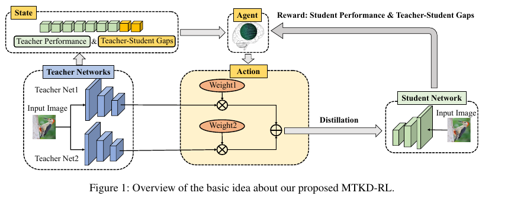
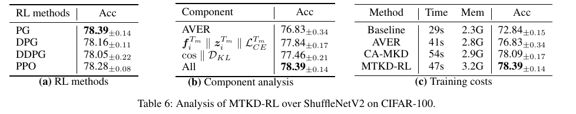

# MTKD-RL 论文汇报：逐页提纲与讲解稿

适用：约 29 分钟，14 页内容；面向正在学习强化学习基础、需要结合自己课题汇报的读者。

论文：Yang et al., *Multi-Teacher Knowledge Distillation with Reinforcement Learning for Visual Recognition*, AAAI 2025，arXiv:2502.18510v1。

本文中的实验数字均来自论文，未在本次准备中重新训练验证。代码分析以当前工作区版本为准，不代表已检查上游最新版本。对自己课题的建议属于研究设计建议。

阅读顺序：先读本文件，再看 [代码核对与答辩备答](code-and-qa.md)。制作 PPT 时，每页只保留“页面内容”，把“讲解”放进演讲者备注。

## 1. 开场：这篇论文回答什么问题？（1 分钟）

**页面内容**

- 多位教师可以提供互补知识。
- 对当前样本，每个教师应该教多少？
- MTKD-RL：根据教师表现、师生差距和学生反馈，学习样本级蒸馏权重。

**讲解**

“老师，我这次汇报 MTKD-RL，主要想弄清多教师蒸馏中强化学习到底起什么作用。这篇论文的直接研究对象是教师的蒸馏权重。多个教师共同指导一个轻量学生，策略网络根据当前样本和师生状态分配权重，再利用学生侧的损失反馈更新策略。它与我们课题的联系，是提供了一种通过反馈学习教师贡献分配的方法。”

**开场后应能回答**：谁提供知识？教师。谁分配权重？策略网络。谁最终部署？学生。

## 2. 先交代知识蒸馏：学生究竟学什么？（2 分钟）

**页面内容**

\[
L_{KD}=L_{CE}(S,y)+\alpha L_{logit}(S,T)+\beta L_{feat}(S,T).
\]

| 损失 | 学习对象 | 直观解释 |
|---|---|---|
| 分类交叉熵 | 真实标签 | 最终类别必须正确 |
| logits 蒸馏 | 教师的软预测分布 | 学会不同类别之间的相对关系 |
| 特征蒸馏 | 教师的中间表示 | 学会教师提取信息的方式 |

**讲解**

“普通监督学习只告诉学生正确类别。蒸馏还提供教师的软预测，以及中间特征。例如教师认为一张图片更像猫、其次像狗，这些相对关系比单一标签包含更多信息。论文默认使用 Hinton KD 和 FitNet，分别约束输出分布和特征。”

术语说明：logits 是 softmax 之前的类别分数；做 KL 蒸馏时要先通过带温度的 softmax 得到概率。当前代码的温度默认是 4，KL 实现的数学方向为教师分布到学生分布，详见代码备答。

多教师只是在这个目标上增加多个指导来源，难点随之变成各教师损失的权重如何设置。

## 3. 为什么教师等权不够？（2 分钟）

**页面内容**

- 教师整体强，不代表在每个样本上都强。
- 教师预测准确，也不保证其特征适合当前学生模仿。
- 同时观察“教师表现”和“师生差距”。

**讲解**

“等权意味着所有教师在所有样本上贡献一样。但是不同教师擅长的类别不同，同一个学生在训练早期和后期的能力也不同。因此，教师价值应该随样本和学生状态变化。”

“这里不能简单说师生差距越小越好。论文在特征分支中偏向语义更匹配的教师，在输出分支中又会强调尚未充分对齐的教师。这是两种不同的设计动机，后面会展开。”

可以用夜间 RGB 与红外教师说明自己课题的动机，但必须注明：这是向多模态场景的类比，论文实验中的教师输入仍是同一幅 RGB 图像。

## 4. 看 Fig.1，把整个闭环讲清楚（2 分钟）

**页面内容**



图源：原论文 Figure 1，第 2 页，裁剪用于论文学习与汇报。

**讲解顺序**

1. 同一幅图像送入多个预训练教师和当前学生。
2. 从教师表现与师生差距构建状态。
3. agent 输出该样本的教师权重。
4. 权重进入蒸馏损失，用来更新学生。
5. 学生侧损失形成奖励，用来更新 agent。

**讲解**

“图中有两个要训练的部分：学生学感知能力，agent 学权重分配。教师已经预训练并固定。强化学习的环境可以理解为整个多教师蒸馏训练过程，动作通过改变学生训练目标产生影响。”

“agent 在实现上是一个小型 MLP，有一个共享隐藏层和两个输出头。‘智能体’在这里指权重决策模块，不需要把它理解成大语言模型。”

## 5. 状态 State：为什么输入这五类信息？（3 分钟）

**页面内容：原文 Eq.(5)**

\[
s_i^m=[f_i^{T_m}\Vert z_i^{T_m}\Vert L_{CE}^{T_m}
\Vert \operatorname{cos}(r_m(f_i^S),f_i^{T_m})
\Vert D_{KL}(p_i^{T_m}\Vert p_i^S)].
\]

这里将 KL 的书写方向明确为当前代码实现的方向；原文使用的是师生分布差异记号。符号 \(\Vert\) 在拼接中表示连接，在 KL 中表示分布参数。

| 状态信息 | 回答的问题 |
|---|---|
| 教师特征 | 教师从这张图中提取到了什么语义？ |
| 教师 logits | 教师如何判断各类别？ |
| 教师 CE | 根据真实标签，教师在这张图上表现如何？ |
| 师生特征余弦相似度 | 两者的特征表示是否匹配？ |
| 师生概率 KL | 两者的预测分布差多少？ |

**讲解**

“前三项描述教师，后两项描述教师与当前学生的关系。学生信息虽然没有以完整特征直接拼入，却通过相似度与 KL 进入状态。所以同一张图、同一个教师，随着学生变化，状态也会变化。”

“不同架构的特征维度不同，不能直接计算相似度。论文用变换对齐；代码为每个教师配置学生特征适配器，再池化得到向量。尺寸匹配只能解决可计算性，不能自动保证跨模态语义已经对齐。”

若教师特征维度为 \(d_m\)、类别数为 \(C\)，单个教师状态维度为 \(d_m+C+3\)。代码将全部教师状态拼接为 \(B\times\sum_m(d_m+C+3)\) 的输入。

**必须点明**：教师 CE 使用训练标签。此状态适用于训练阶段，不能原样搬到无标签的在线检测策略中。

## 6. 动作 Action：输出权重，也融合已有规则（3 分钟）

**页面内容**

共享 MLP → 两个 softmax 输出头：

\[
w_{gen,l},w_{gen,f}\in\mathbb R^M.
\]

最终动作还有另外两类权重：

\[
w_{conf,m}=\frac{1-\operatorname{softmax}(L_{CE}^{T_1},\ldots,L_{CE}^{T_M})_m}{M-1},
\]

\[
w_{div,f}=\operatorname{softmax}(\operatorname{cos}_1,\ldots,\operatorname{cos}_M),
\quad
w_{div,l}=\operatorname{softmax}(KL_1,\ldots,KL_M).
\]

默认融合方式：

\[
w_f=(w_{gen,f}+w_{conf}+w_{div,f})/3,
\quad
w_l=(w_{gen,l}+w_{conf}+w_{div,l})/3.
\]

**讲解**

“实际用来蒸馏的权重融合了三部分：网络生成、教师可信度、师生差异。教师分类损失越小，可信度权重越大。特征越相似，特征分支的差异感知权重越大。输出 KL 越大，输出分支则给更强指导，作者希望补足尚未对齐的输出知识。”

“这也解释了为什么特征与 logits 要分别输出权重：它们承担的知识类型和匹配需求不同。”

**代码细节**：`--dynamic` 控制上述三部分的融合系数是否可学习。关闭这个开关，教师权重仍随样本状态变化；不能把它解释成关闭样本自适应。

## 7. 权重用在哪里？是对损失加权（2 分钟）

**页面内容：原文 Eq.(2)**

\[
L_i=L_{CE}(S(x_i),y_i)
+\alpha\sum_{m=1}^M w_{l,i}^mL_{logit,i}^m
+\beta\sum_{m=1}^M w_{f,i}^mL_{feat,i}^m.
\]

- \(w_{l,i}^m\)：第 \(i\) 个样本向第 \(m\) 位教师学习输出知识的强度。
- \(w_{f,i}^m\)：相应的特征学习强度。
- 论文默认 \(\alpha=1,\beta=5\)。

**讲解**

“这里是逐教师计算蒸馏损失，再按权重求和。原文 Fig.1 画出了集合指导的直观关系，具体公式和当前代码都采用加权损失形式。对于异构教师，学生特征先映射到各教师的空间，再分别比较。”

“所以向自己的课题迁移时，不能直接把它表述成先把所有原始教师特征图相加。教师的通道、尺度、空间坐标以及模态语义可能不同，需要先确定对齐与融合方案。”

## 8. 奖励 Reward：学生侧的负损失（2 分钟）

**页面内容：原文 Eq.(6)**

\[
R_i^m=-L_{CE,i}^S-\alpha L_{logit,i}^m-\beta L_{feat,i}^m.
\]

- 分类损失衡量学生是否预测正确。
- 蒸馏损失衡量学生与教师是否对齐。
- 损失越小，负损失越大。

**讲解**

“奖励由学生侧的损失构成。可以把负号理解成把最小化损失转为最大化奖励。例如损失从 2 降到 1，对应奖励从负 2 变成负 1，后者更好。”

“这里的奖励是性能代理量，不能直接等同于准确率提升、mAP 提升或长期泛化增益。奖励大也不意味着已验证该教师对学生有更大的因果贡献。”

在相同样本的跨教师比较中，学生 CE 是各教师共同项；对其做一致的中心化或比较时，这个公共项可能被抵消。实际各项对策略学习的作用需要结合归一化与实现分析，不能只凭奖励公式下结论。

## 9. 如何交替训练？（2 分钟）

**页面内容：原文 Algorithm 1、2**

```text
预训练并固定教师
        ↓
等权蒸馏学生 1 个 epoch，收集训练信息
        ↓
用收集的信息初始化 agent
        ↓
重复：
  固定 agent，用生成的权重训练学生并记录状态、动作、奖励
  固定学生，用历史信息更新 agent
        ↓
输出学生，推理阶段使用学生
```

**讲解**

“两个模块交替更新：学生适应当前权重，权重策略适应学生状态。预热阶段避免随机策略在学生还很弱时提供不稳定指导。”

“论文伪代码按 epoch 收集、再训练 agent。当前代码按 `agent_step` 周期及 epoch 末尾训练 agent，默认周期为 1000 个 batch。读实现时还要区分 `eval()` 和真正的梯度隔离，学生训练阶段的权重由 `no_grad()` 和 `detach()` 隔离。”

等权预热中每个教师的权重设置为 1，表示同等强度；它与权重为 \(1/M\) 的归一化平均在总蒸馏强度上有区别，比较时应保持损失尺度一致。

## 10. 强化学习与代码：讲清原理，保留实现边界（2 分钟）

**页面内容**

标准随机策略梯度的背景公式：

\[
\nabla_\theta J=\mathbb E[A(s,a)\nabla_\theta\log\pi_\theta(a\mid s)].
\]

- 有利的决策提高其再次出现的概率。
- baseline 用于比较奖励并降低梯度方差。
- 本文采用作者所称的 PG 框架，未提出新的 RL 算法。

**讲解**

“我学习强化学习时，会用这个标准公式理解反馈优化的意图。但它是背景知识，不能说它就是原文 Eq.(7) 的逐项改写。论文和当前代码中的具体表达与标准随机 REINFORCE 存在差异。”

“当前策略网络直接输出连续 softmax 权重，没有显式的随机连续动作采样；策略训练使用奖励加权的 BCE，奖励也变成 batch 内的样本标量。它与论文逐教师奖励的写法不同。我在备答里记录了位置，复现前需要单独验证这些差异。”

**阅读代码顺序**

1. `get_agent_state()`：五类信息怎么组成状态。
2. `PolicyTrans.forward()`：双头权重与三路融合。
3. `train()`：权重怎样控制学生损失。
4. `train_agent()`：策略究竟怎样更新。

## 11. 主实验：收益究竟来自哪里？（2 分钟）

**页面内容：原文 Table 1、2**

| 方法 | CIFAR-100 / ShuffleNetV2 Acc@1 |
|---|---:|
| 无蒸馏基线 | 72.84 ± 0.15 |
| 等权 KD | 75.77 ± 0.18 |
| 等权 KD + FitNet | 76.83 ± 0.34 |
| CA-MKD | 78.09 ± 0.17 |
| MMKD | 77.87 ± 0.20 |
| MTKD-RL | 78.39 ± 0.14 |

论文对 Table 1 报告 3 次运行。

- 对无蒸馏基线：提升 5.55 个百分点。
- 对等权 KD + FitNet：提升 1.56 个百分点。
- 对 CA-MKD：提升 0.30 个百分点。
- ImageNet / ResNet-18：70.35 → 72.82；等权 KD + FitNet 为 71.56。

**讲解**

“5.55 个百分点是整个蒸馏体系对基线的总收益，包含多教师与特征蒸馏的作用。评价本文权重机制，应重点看与采用相同蒸馏损失的等权方法相比的 1.56 个百分点。对已有强方法 CA-MKD，收益是 0.30 个百分点。”

“完整方法还包括启发式权重融合，因此这些结果也不能直接解释成所有收益都来自纯策略梯度部分。若自己的课题要证明 RL 的价值，需要增加相同状态、相同教师和相同蒸馏目标下的普通可学习门控对照。”

## 12. 消融：什么证据支撑设计？（2 分钟）

**页面内容：原文 Figure 2、Table 6**



图源：原论文 Table 6，第 7 页。

| 对比 | 准确率 | 可以得到的结论 |
|---|---:|---|
| 等权 AVER | 76.83 | 权重分配基准 |
| 教师信息相关配置 | 77.84 | 教师表现提供有用信息 |
| 师生差距相关配置 | 77.46 | 匹配信息也有用 |
| 完整配置 | 78.39 | 两类信息合用最好 |

原文把该项描述为构造 state 和 action 的 component analysis；汇报时不宜断言这是严格保持其余所有因素不变的纯状态输入消融。

PG / PPO / DPG / DDPG 分别为 78.39 / 78.28 / 78.16 / 78.05。可以说本文测试的配置下结果相近、简单 PG 已有竞争力；不足以推出所有任务中 RL 算法选择都不重要。

训练成本对 AVER：每 epoch 41s → 47s，约增加 14.6%；显存 2.8G → 3.2G，约增加 14.3%。这些是特定硬件、网络和训练设置下的训练开销，不能当作边缘推理延迟。

教师数量在该实验中增加到约 4 个后收益趋于饱和，不能据此给所有任务固定 4 个教师。

## 13. 论文验证到了哪里？（2 分钟）

**页面内容**

- 核心训练任务：RGB 图像分类，多架构教师到单学生。
- 检测/分割：将 ImageNet 蒸馏骨干迁移到下游任务。
- 学习样本级教师贡献；未解决跨模态配准、检测框对应或雷达稀疏特征对齐。
- 需要进一步核对策略优化公式、奖励归一化与当前代码的一致性。

**讲解**

“Table 4 是蒸馏预训练后的骨干迁移到 COCO 检测。例如 ResNet-18 Faster R-CNN 从 33.5 到 34.7 mAP，ResNet-34 Faster R-CNN 从 37.0 到 38.5。这说明学到的表征对检测有帮助，尚不能直接证明多教师检测头和边界框蒸馏方案有效。”

“论文同时考虑了架构不同的教师，但仍共享 RGB 输入。我们课题增加了模态差异、检测任务结构和边缘部署约束，因此是需要重新设计和验证的扩展。”

**措辞边界**：不要把“不同架构”概括成所有教师同构；也不要把“多教师”直接等同于“多模态”或“多智能体强化学习”。

## 14. 与自己课题的连接及下一步（2 分钟）

**页面内容**

| 维度 | MTKD-RL | 我的课题需要补充 |
|---|---|---|
| 教师 | 多架构 RGB 分类网络 | 模态与专长互补的检测教师 |
| 状态 | 教师表现、师生差距 | 场景、模态质量、检测与匹配信息 |
| 决策 | 训练期蒸馏权重 | 明确集合融合权重与蒸馏权重的关系 |
| 反馈 | 学生侧负损失 | 按研究目标选择学生增益或集合质量 |
| 知识迁移 | 输出 + 特征蒸馏 | 特征、分类、回归与决策迁移的有效证据 |
| 部署 | 学生模型 | 明确学生输入模态、硬件与完整延迟 |

**建议向老师这样说**

“这篇论文对我最直接的启发，是利用教师质量、师生匹配和学生反馈共同学习蒸馏强度。结合课题，我认为先要明确 RL 优化的是高精度教师集合，还是学生的训练配方。如果目标是最终只部署学生，训练期自适应蒸馏权重更接近本文，也更容易先建立完整基线。”

“如果保留 DQN，我会先把动作定义为有限组权重模板；如果直接输出连续权重，就选适合连续动作的策略方法。另外，学生加入场景调制模块只提供了自适应能力，是否迁移到教师策略，还需要显式的策略监督或消融证据。”

“我下一步准备先跑通单模态、双教师、轻量检测学生的等权蒸馏，然后比较普通可学习门控和 RL 权重策略；在确认策略带来独立收益之后，再引入配准的 RGB-红外数据。雷达待确认同步、标定和数据条件后单独增加。”

## 两天准备安排

**第一天：把方法讲通。**

- 顺着第 1～9 页，用自己的话复述一次，不先背符号。
- 手算负损失奖励、softmax 权重、加权 KD；弄懂权重为什么是 \(B\times M\)。
- 按第 10 页的顺序定位四个代码入口，并能说清每个入口的输入输出。
- 对照原文第 4 页看 Eq.(5)～(8)、Algorithm 1～2；对照第 8 页理解三路权重融合。

**第二天：做汇报与备答。**

- 将 14 页提纲转成 PPT，核心图使用原文 Fig.1，主实验选 Table 1、消融选 Table 6。
- 先讲论文，再讲课题连接；自己的设想用“拟采用、待验证”标注。
- 计时演练一次，主线控制约 29 分钟；代码核对与课题细节放在备份页。
- 优先练习备答中的 1～8 题，特别是“为什么用 RL”“DQN 能否输出连续权重”“检测实验到底做了什么”。

## 来源与定位

- [原论文 PDF](../../2502.18510v1.pdf)：第 2 页 Fig.1；第 3～4 页 Eq.(1)～(8) 与算法；第 5～7 页实验；第 8 页附录 Action Construction。
- [论文文本抽取](../base-paper-fulltext.txt)：便于检索；公式以 PDF 为准。
- [状态、学生训练与策略训练](../../MTKD-RL/train_loops.py)：`get_agent_state`、`train`、`train_agent`。
- [策略网络与三路融合](../../MTKD-RL/models/policy.py)：`PolicyTrans`。
- [特征适配](../../MTKD-RL/models/util.py)：`TransFeat`、`Embed`。
- [KL 实现](../../MTKD-RL/utils.py)：`DistillKL`。
- [训练入口与超参数](../../MTKD-RL/train_student_rl.py)：`get_agent`、两个优化器、`agent_step`。
- [实现说明](../../MTKD-RL/README.md)：`--dynamic` 的实现选项与结果，勿与论文 Table 1 的数字混用。
